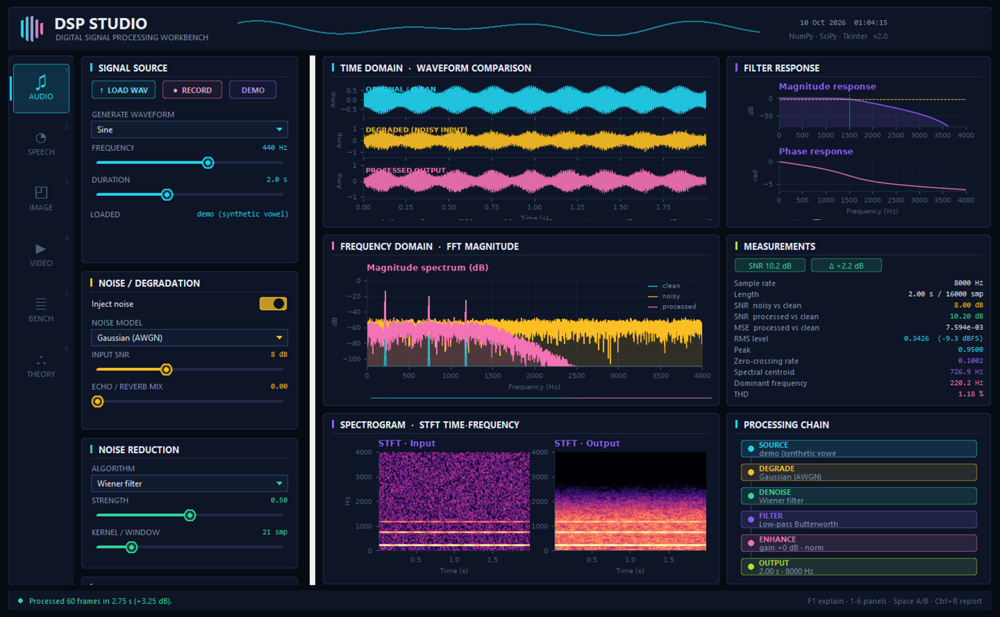
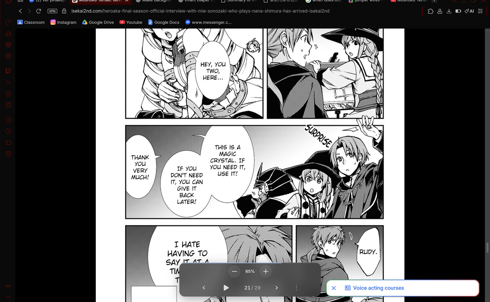
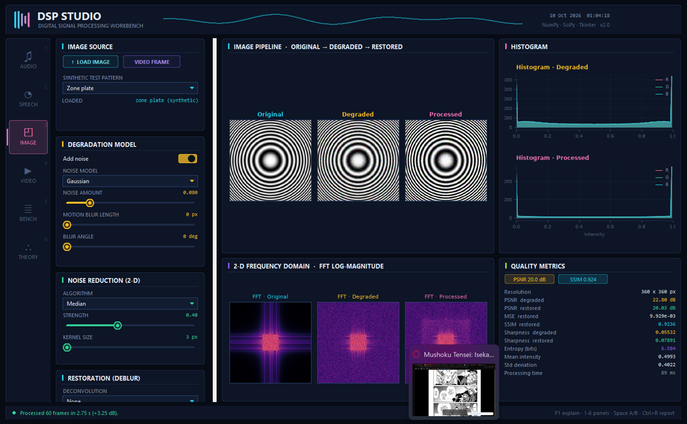
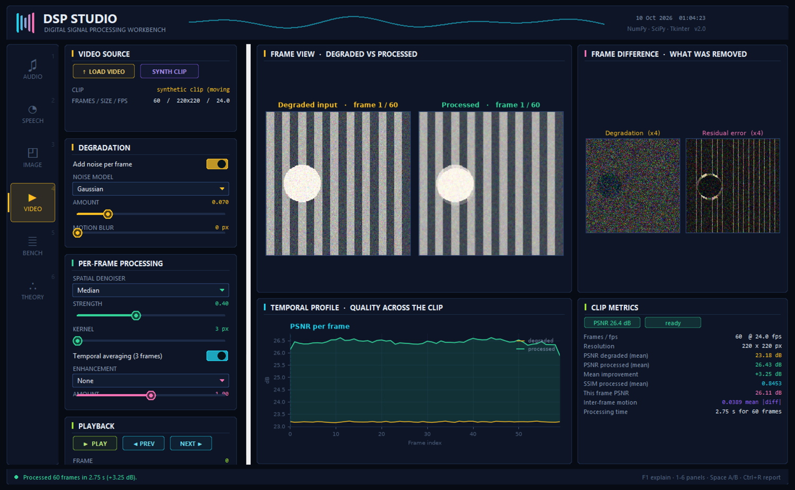
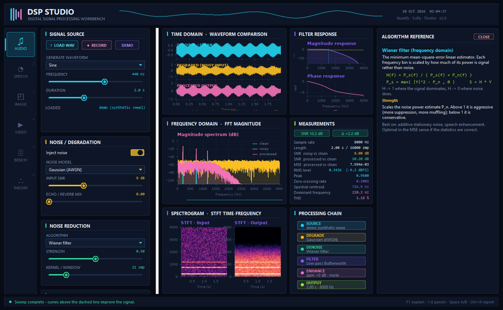

# DSP STUDIO — Digital Signal Processing Workbench

A Tkinter desktop application built as a group final project for CPE07A
Digital Signal Processing. It acquires 1-D (audio / speech) and 2-D (image / video) signals, degrades them
with controllable noise and blur models, then restores and enhances them with
classical DSP algorithms — showing every stage as a waveform, spectrum,
spectrogram, pitch track, MFCC map, 2-D FFT, histogram and a numeric quality
report.

The whole interface is hand-drawn on `tk.Canvas` (cards, sliders, switches,
dropdowns, meters, tables, progress bars, nav rail) over a dark red and charcoal
theme; the plots are Matplotlib figures themed to match.



## Run

```bash
pip install -r requirements.txt
python main.py
```

Python 3.10+. `sounddevice` is optional (microphone capture and playback —
playback falls back to `winsound` on Windows). `opencv-python` is needed to
open video files (LOAD VIDEO, VIDEO FRAME) and to save MP4 clips; without it
only the synthetic clip works and clips are saved as PNG sequences.

## Using it

**Quick Start presets.** Each processing panel opens with a QUICK START card:
one click configures a whole scenario — *Hiss removal*, *Hum removal*, *Click
repair*, *Voice band*, *Photo denoise*, *Scan repair*, *Deblur*, *Moire
removal*, *Spatial + temporal*… The status bar says what the preset
demonstrates and the reference drawer explains it. Every control stays editable
afterwards, so a preset is a starting point, not a mode.

**A consistent dark red interface.** Shared burgundy surfaces, rose accents,
readable text, and matching scrollbars are used across all four workbenches.
Clean, noisy, and processed signals keep distinct colors for comparison.

**Reference on demand.** Use the REFERENCE button in the header or `F1` for
algorithm explanations. The drawer overlays the workspace without squeezing
or resizing your charts; it stays closed on launch.

**Type size is one number.** `UI_FONT_STEP` in `dspstudio/theme.py` adds a point
offset to the shared typography scale (`0` by default). Tk fonts and widget
spacing use the same pixel scale. Matplotlib applies the display DPI once,
and automatically lays out titles, ticks, and labels within each graph.

**Foldable control cards.** Click any control card's header to fold it down to
its title bar. Folding the sections you are not demonstrating fits the whole
column on screen without scrolling.

**Readable on scaled displays.** The app is per-monitor DPI aware. Graphs
and controls stay in proportion at 100%, 150%, and 200% display scaling.
Chart workspaces have minimum readable sizes and scroll when a smaller window
cannot fit them. Long labels are shortened instead of overlapping values;
measurement tooltips show the complete label and value.

**Forgiving controls.** Sliders respond to a click anywhere on the row, to
dragging, and to the arrow keys once focused; switches and dropdowns have
full-row hit targets; most controls carry a hover tooltip.

## Keyboard

| Key | Action |
|---|---|
| `1` – `4` | Switch workbench |
| `F1` | Open / close the algorithm reference drawer |
| `Space` | A/B flip the comparison pane |
| `Ctrl+R` | Export a PDF report of the current panel |
| `Ctrl+S` | Save the current output (WAV / PNG / clip) |
| `Esc` | Quit |

The layout detects small screens (e.g. a 1366×768 projector) and switches to a
compact scale automatically; the status bar says which one is active. Control
cards measure their own contents, so nothing clips when the font size changes.

## The four required workbenches

### 1. AUDIO
Pipeline: **source → degradation → noise reduction → filtering → enhancement → analysis**

| Stage | Implemented |
|---|---|
| Source | WAV load, microphone capture, generated test signals (sine, square, chirp, multi-tone) |
| Degradation | AWGN, pink (1/f), 60 Hz mains hum + harmonics, impulse clicks — injected at a chosen input SNR |
| Noise reduction | Spectral subtraction (Boll), frequency-domain Wiener, median de-click, moving-average FIR |
| Filtering | Butterworth / Chebyshev I / Elliptic IIR and windowed FIR; LP / HP / BP / BS; order 1–12; zero-phase or causal |
| Enhancement | Noise gate, normalisation |
| Analysis | Waveforms, FFT overlay, STFT spectrograms in/out, magnitude + phase response, SNR in/out and Δ, MSE, RMS/dBFS, peak, ZCR, spectral centroid, dominant frequency, THD |

### 2. SPEECH


| Feature | Implemented |
|---|---|
| Source | WAV, 4-second microphone capture, or source-filter vowel synthesis (glottal pulse train through formant resonators) |
| Pitch | F0 by autocorrelation (with parabolic interpolation and median smoothing) and by real cepstrum, overlaid on one track |
| Formants | LPC via Levinson–Durbin; pole angles give F1–F4, drawn on the LPC spectral envelope |
| Features | Mel filterbank energies and MFCC (pre-emphasis → mel → log → DCT-II), with delta features available |
| Segmentation | Energy + zero-crossing voice activity detection with adaptive threshold and smoothing, shaded on the waveform |
| Channel | Telephone-band (300–3400 Hz) simulation, plus the full audio enhancement chain |
| Measurements | F0 mean/min/max, voiced %, segment count, speech vs silence, formants, ZCR, frame energy, SNR |

### 3. IMAGE


| Stage | Implemented |
|---|---|
| Source | Image file, video frame, or synthetic patterns (checkerboard, gradient, circles, zone plate, bars) |
| Degradation | Gaussian, salt & pepper, speckle, Poisson, periodic (moiré) noise; motion blur with length and angle |
| Noise reduction | Gaussian, median, bilateral, fast non-local means, local Wiener, 2-D Butterworth FFT low-pass, spectral notch |
| Restoration | Wiener deconvolution, inverse filter, Richardson–Lucy |
| Enhancement | Unsharp mask, histogram equalisation, CLAHE-style, gamma, contrast stretch, Sobel and Canny-style edges |
| Analysis | Original / degraded / processed, their 2-D FFTs, RGB histograms, PSNR, MSE, SSIM, sharpness, entropy, runtime |

### 4. VIDEO


Decodes a clip (or builds a synthetic one), degrades and processes **every
frame**, and plays the result back with a scrubber. Adds **motion-adaptive
temporal averaging** over 5 frames — noise is independent between frames so it
cancels, which a single-frame 2-D filter cannot do, and neighbours that differ
because something moved get less weight, so moving edges are not smeared. An
optional **Wiener deblur** inverts added motion blur frame by frame. Shows the
degradation and the residual error as amplified difference images, plots PSNR
across the whole clip, and exports MP4 (or a PNG sequence when no video writer
is installed). Long clips are capped at 150 frames and 420 px, so keep demo
clips to about 5–10 seconds.

## Algorithm reference drawer (F1)



Selecting any algorithm pushes its definition, formula and parameter meaning
into the right-hand drawer — what it does, the equation, what each knob changes,
and when it is the right choice. Hovering most controls also shows a tooltip.

## PDF reports

`Ctrl+R` in any panel writes an A4 PDF: a cover page listing the full pipeline
configuration and the measured metrics, then one page per figure.

## Project layout

```
main.py                     entry point
requirements.txt
samples/                    ready-made WAV / PNG test material
assets/                     screenshots
dspstudio/
  theme.py                  palette, fonts, responsive scaling, canvas helpers
  widgets.py                custom canvas widgets (Card, Slider, Tooltip, ...)
  plots.py                  themed Matplotlib panes, cursor/zoom, heat maps
  jobs.py                   worker threads with a queue-and-poll bridge to Tk
  dsp_audio.py              1-D DSP engine
  dsp_speech.py             speech features and vowel synthesis
  dsp_image.py              2-D DSP engine
  explain.py                algorithm reference text
  presets.py                one-click demonstration scenarios
  report.py                 PDF processing report builder
  app.py                    shell: splash, header, nav rail, explain drawer
  panels/                   audio, speech, image, video
```

All signal processing lives in `dsp_audio.py`, `dsp_speech.py` and
`dsp_image.py`; the GUI never touches raw maths, so each algorithm can be
explained and tested on its own.

## Sample material (`samples/`)

| File | Use |
|---|---|
| `clean_tone.wav` | reference signal |
| `noisy_tone_5dB.wav` | AWGN at 5 dB SNR — spectral subtraction / Wiener demo |
| `hum_60hz.wav` | mains hum — band-stop notch demo |
| `chirp_sweep.wav` | frequency sweep — spectrogram demo |
| `speech_vowels.wav` | synthesised utterance — pitch, formant, MFCC, VAD demo |
| `speech_vowels_noisy.wav` | the same at 5 dB SNR — speech enhancement demo |
| `test_pattern.png` | checkerboard — sharpening and edges |
| `blurred_noisy.png` | motion blur + salt & pepper — median + deconvolution |
| `moving_scene.mp4` | clean 5 s, 24 fps street scene with moving objects — load it, let the program add noise, compare Spatial Only vs Spatial + Temporal |
| `moving_scene_noisy.mp4` | the same clip with noise already in it — real noisy footage (no clean reference inside the program) |

## Rubric and demonstration

Audio, speech, image, and video are all required for this project. See
[RUBRIC_ALIGNMENT.md](RUBRIC_ALIGNMENT.md) for the seven grading criteria,
the features that support them, and a short four-part demo script.

The scope was deliberately trimmed to the required processing: near-duplicate
methods (extra test waveforms, redundant denoisers, filters and edge
detectors) and off-topic extras (benchmark/theory labs, echo/reverb,
compressor, decorative animations) were removed so every remaining control
serves noise reduction, restoration, filtering or analysis.

## Interface verification

Run `python tools/verify_ui.py` to check graph text bounds, DPI scaling, and
measurement overlap across all four workbenches at three window sizes. Use
`--dpi 96` or `--dpi 144` to simulate 100% or 150% scaling, and `--keep-open`
to leave the verified app open. Results are written to `tools/ui-checks/ui-verification-<dpi>.json`.

## Tech stack

Python · Tkinter · NumPy · SciPy · Matplotlib · Pillow · OpenCV · sounddevice
